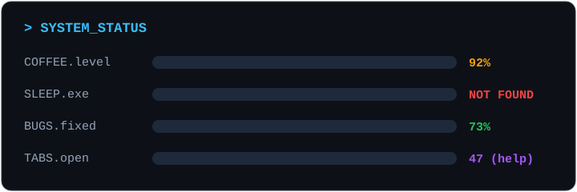

<div align="center">


<a href="https://git.io/typing-svg">
  
</a>

<br/><br/>


<br/>


<br/>



<br/>


## ⌨️ Tech Stack


### Languages


<br/><br/>


### Frontend


<br/><br/>


### Backend & APIs


<br/><br/>


### AI & Agentic


<br/><br/>

### Database


<br/><br/>


### Tools & Others


<br/><br/>


<br/>



</div>

<br/>

```python
class Alejo:
    def __init__(self):
        self.status = "compiling..."
        self.sleep_hours = None  # NullPointerException
        self.tabs_open = 47

    def fix_bug(self, bug):
        try:
            return self.google(bug) or self.ask_ai(bug)
        except Exception:
            return "have you tried turning it off and on again?"
```

<div align="center">


</div>